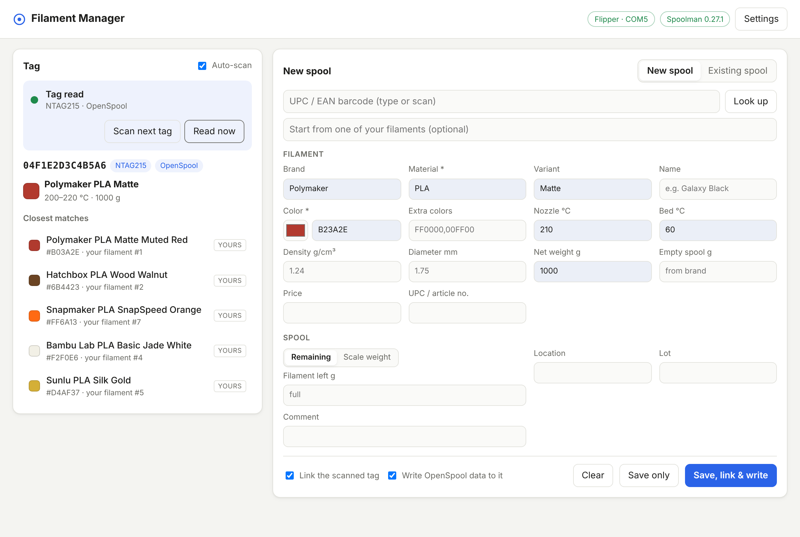
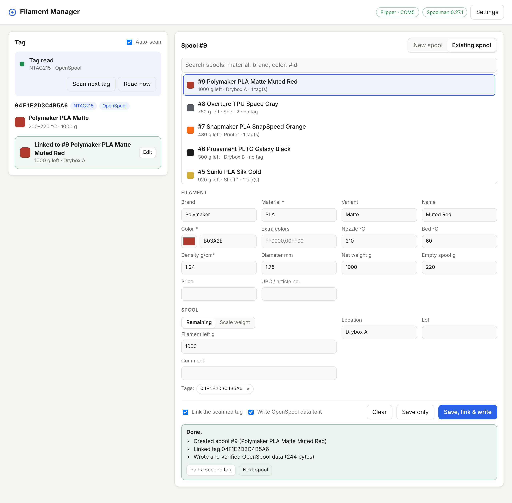
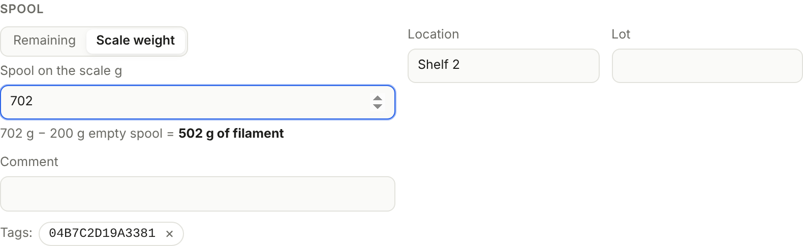
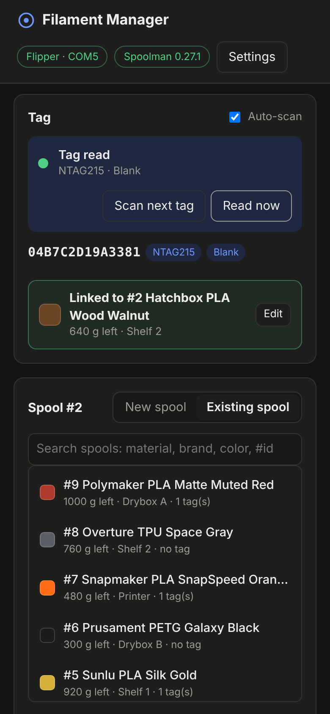

# Flipper-SpoolTag

Tested with a Flipper Zero on Momentum firmware `mntm-012`, Spoolman 0.27, NTAG215 stickers, and the [Snapmaker U1 extended firmware](https://github.com/paxx12-snapmaker-u1/SnapmakerU1-Extended-Firmware). It should work on any OS Python and pyserial run on.

A local web page for adding spools to Spoolman and tagging them with NFC, using a Flipper Zero as the reader and writer. It follows SpoolPainter's workflow, from a PC, for the Snapmaker U1 extended firmware (SpoolLink).

## Screenshots

A scanned OpenSpool tag that isn't in Spoolman yet. The form fills in from the tag, and the closest filaments you already have are listed on the left.



After **Save, link & write**: the spool is created, the tag is linked as a Spoolman tag, and the OpenSpool data is written and read back.



Entering a used spool from its weight on a scale:



On a phone, in dark mode:



The screenshots use simulated tags (`--fake`) and a demo Spoolman.

## Setup (Windows, PowerShell)

Needs Python 3.10+ and `pyserial`. Find your Flipper's COM port in Device Manager (it's auto-detected if you leave `--port` out).

```powershell
git clone https://github.com/nreed97/Flipper-SpoolTag.git
cd Flipper-SpoolTag
pip install pyserial
python -m filament_manager.server --port COM5 --spoolman http://192.168.1.100:7912
```

Open http://localhost:8765. The Spoolman URL is saved to `config.json`, so next time `python -m filament_manager.server --port COM5` is enough. You can also change it, and the tag storage mode, under **Settings** on the page.

Close qFlipper and the Flipper web CLI first. Only one program can hold the serial port.

Options: `--fake` simulates a Flipper and tags (with buttons on the page to swap tags), `--offline` never sends UPCs to upcitemdb, and `--debug` prints every Flipper command.

## Using the page

1. **Scan.** Auto-scan waits for a tag and reads it as soon as it touches the Flipper, then stops. **Scan next tag** waits for a different tag. **Read now** reads whatever is on the Flipper right away.
2. **The page looks the tag up in Spoolman.**
   - If the tag is already linked, you see that spool and the form opens it for editing.
   - If it isn't linked but carries data (OpenSpool or Anycubic ACE), the form fills in from the tag. You also get the closest matches from your own filaments and from SpoolmanDB, and clicking one fills the form from it.
3. **New spool.** Optionally type or scan a **UPC** and press **Look up**. The page checks your Spoolman's article numbers first, then upcitemdb and SpoolmanDB. You can also start from one of your existing filaments. Fill in anything still blank.
4. **Save, link & write.** This creates or updates the spool in Spoolman, links the tag's UID, and writes OpenSpool data to the tag (NTAG only), then reads it back to check. If the tag belongs to another spool, the page asks before moving it. **Save only** skips the tag.
5. **Pair a second tag** links another sticker to the same spool, for example one on each side of the spool.

**Used spools:** under Spool, switch from **Remaining** to **Scale weight** and type what the scale shows with the spool on it. The page subtracts the empty spool weight, taken from the **Empty spool g** field, or from the brand's empty spool weight in Spoolman if that field is blank, and shows the result before you save. The empty spool weight is stored on the spool, so Spoolman and the printer can use it later.

Existing spool edits only send the fields you changed, so a remaining weight the printer updated in the meantime isn't overwritten. Changing filament fields on an existing spool changes that filament for every spool that uses it. On a new spool, changing the brand, material, name, color or variant of a filament you started from creates a new filament instead.

## How tags are linked

The page follows the U1 extended firmware's SpoolLink conventions:

- UIDs are uppercase hex with no separators.
- **Spoolman tags** (default): Spoolman's own tag links (v0.27+), shown in the spool's Tags section. To match, set the printer's hidden **Spoolman Tag Storage** setting (firmware-config with `?hidden` on the URL) to **Spoolman native tags**.
- **Card UIDs**: the spool's `card_uids` extra field, a JSON-encoded comma-separated list (SpoolLink's default). The page creates that field only in this mode.
- When a tag that was linked through `card_uids` is scanned in Spoolman tags mode, it's moved to a native tag automatically.
- A UID belongs to one spool at a time.
- A spool can have more than one tag. Snapmaker spools have one on each side with different UIDs, and both get linked so the printer finds the spool whichever way it faces. When saving, tick **Spool has a second tag: scan it next** (on by default for Snapmaker tags) and the app waits for the other tag right after. Scanning an unlinked tag that matches a spool with only one tag also offers "Other tag of spool #N" at the top of the matches, so the second side doesn't become a duplicate spool.

The OpenSpool data written to the tag includes `spool_id`, so other SpoolLink apps can find the spool too.

## What it can read

| Tag | What you get |
|---|---|
| NTAG with OpenSpool data | UID plus the filament fields |
| NTAG written by Spool Programmer / ACE-RFID (Anycubic ACE format) | UID plus the filament fields |
| Blank or other NDEF NTAG | UID and the raw NDEF records |
| Snapmaker spool (Mifare Classic 1K) | UID plus the filament fields (brand, material, color, temps, weight, SKU); signature checked against Snapmaker's public keys |
| Other Mifare Classic (Bambu, Creality, ...) | UID only, so it can still be linked; their data needs keys this app doesn't have |

Writing is NTAG213/215/216 only. Pages 0 to 3 (UID, lock bits, Capability Container) are never written.

## Flipper commands used

Checked against the Momentum `mntm-012` source (`applications/main/nfc/cli`).

- Waiting for a tag: `scanner` in the `nfc` shell blocks until a tag shows up. Ctrl+C aborts it.
- Reading: `storage remove /ext/nfc/filament_manager.nfc`, then `dump -p mfu -f /ext/nfc/filament_manager.nfc`, then `storage read` of that file, parsed as a Flipper `.nfc` file.
- Mifare Classic: the CLI's `dump -p mfc` only reads with keys from the Flipper's key cache, and fails with "failed to read" otherwise. So the app first runs `dump -p 14_3a` to get the UID, derives that tag's Snapmaker sector keys (HKDF-SHA256 from the UID, as the U1 does), writes them to `/ext/nfc/.cache/<UID>.keys` with `storage write_chunk`, then runs `dump -p mfc`. If those keys don't work the file is removed again and the tag is returned as UID only. An existing cache file is never overwritten. A bonus: once the cache file exists, the Flipper's own NFC app reads that spool instantly too.
- Writing: `mfu rdbl -b N` to check the UID and Capability Container, `mfu wrbl -b N -d AABBCCDD` for each page, then a full read to verify.

`raw` is avoided on purpose. In mntm-012, the second `raw` call in a session reuses freed memory and stalls the CLI.

## Tests

```powershell
python -m unittest discover tests
```

These use a simulated Flipper (`filament_manager/fake.py`). `tests/test_spoolman_live.py` also exercises a real Spoolman, but only when `SPOOLMAN_TEST_URL` is set. Point that at a throwaway Spoolman, never your real one, because it creates records.

`probe_flipper.py` is a read-only hardware check that saves `probe_log.txt`.

## Files

- `filament_manager/server.py`: local HTTP API and static page
- `filament_manager/static/`: the page (`index.html`, `app.js`, `app.css`)
- `filament_manager/flipper.py`: serial driver; waits for, reads and writes tags
- `filament_manager/spoolman.py`: Spoolman client with the SpoolLink conventions
- `filament_manager/lookup.py`: tag and UPC lookups (Spoolman, upcitemdb, SpoolmanDB)
- `filament_manager/ndef.py`, `openspool.py`, `ace.py`: tag formats

## Credits

- Tag formats and the SpoolLink conventions come from the [Snapmaker U1 extended firmware](https://github.com/paxx12-snapmaker-u1/SnapmakerU1-Extended-Firmware) docs and [OpenSpool](https://openspool.io/).
- The Anycubic ACE tag layout was worked out from [DnG-Crafts/ACE-RFID](https://github.com/DnG-Crafts/ACE-RFID).
- The workflow was inspired by [SpoolPainter](https://github.com/ni4223/SpoolPainter). No code was copied from it.
- [Spoolman](https://github.com/Donkie/Spoolman) and SpoolmanDB do the inventory work.

## License

MIT, see [LICENSE](LICENSE).
